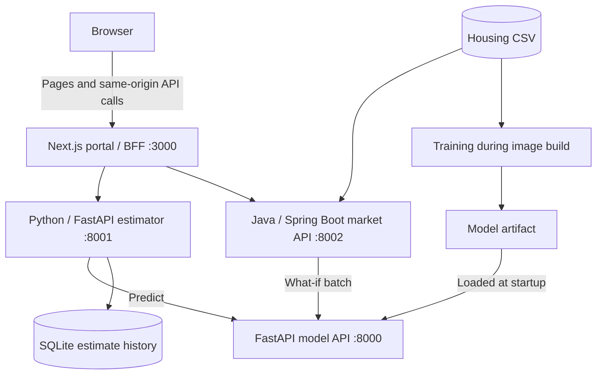

# Housing Analytics Portal

**Live demo:** [housing-analytics-portal.adamliu.app](https://housing-analytics-portal.adamliu.app/)

A housing price prediction API and a Next.js portal combining a Python property estimator with a Java market analysis application. Built for the fullstack take-home assignment.

## Run locally

Requires Docker Desktop, or Docker Engine with Compose v2. Clone the repository and start the stack:

```bash
git clone https://github.com/adam0x01/housing-analytics-portal.git
cd housing-analytics-portal
docker compose up --build -d --wait --wait-timeout 180
docker compose ps
```

- Expect four healthy services.
- Docker supplies Node 22, Python 3.12, and Java 21; no host runtimes, environment file, or API keys are required.
- The first build needs internet access and free ports 3000, 8000, 8001, and 8002.
- It includes the supplied datasets and trains the model automatically.

| Application | Local URL | Folder | Features | Stack / development guide |
| --- | --- | --- | --- | --- |
| Web portal | [localhost:3000](http://localhost:3000) | [apps/web/](apps/web/) | Shared navigation, server-rendered initial data, same-origin API proxy, responsive layouts, loading/error states, light/dark themes | [Next.js App Router, TypeScript, Tailwind, shadcn/ui](apps/web/README.md) |
| Model API / Swagger | [localhost:8000/docs](http://localhost:8000/docs) | [services/housing-model-api/](services/housing-model-api/) | Single and batch predictions, coefficients, evaluation metrics, health | [Python 3.12, FastAPI, scikit-learn](services/housing-model-api/README.md) |
| Value estimator API / Swagger | [localhost:8001/docs](http://localhost:8001/docs) | [services/estimator-api/](services/estimator-api/) | Validated seven-feature form, result table/chart, saved history, comparison of 2–4 properties | [Python, FastAPI, SQLite](services/estimator-api/README.md) |
| Market analysis API / Swagger | [localhost:8002/docs](http://localhost:8002/docs) | [services/market-api/](services/market-api/) | Segment filters, interactive charts, sortable tables, what-if scenarios, CSV/PDF exports, cached aggregates | [Java 21, Spring Boot 3.4.4, Caffeine](services/market-api/README.md) |

The hosted demo may take a moment to wake after inactivity. Model Swagger is available locally for the interview demonstration; hosted backend services use private networking.

Run operational commands from the repository root:

```bash
docker compose logs -f                 # Follow logs; Ctrl+C exits the log viewer
docker compose stop                   # Stop, preserving containers and data
docker compose up -d --wait            # Start again
docker compose down                   # Remove containers; preserve saved estimates
```

Saved estimates persist in a SQLite volume; `docker compose down --volumes` deletes that history. Optional port, URL, and timeout settings are in [`.env.example`](.env.example). Native startup instructions are linked in the application table above.

## Architecture and data flow



### Request flow

1. **Estimate a property:** The browser submits features through Next.js to the Python estimator. It validates the input, calls the model API, saves the successful result in SQLite, and returns the estimate.
2. **Explore the market:** Next.js calls the Java API for filtered statistics, charts, and exports. Java reads its dataset snapshot and caches aggregate responses with Caffeine for five minutes.
3. **Run a what-if scenario:** The Java API sends the reference and scenario features together to the model's batch endpoint and returns both predictions and their difference.

### Next.js as the Backend for Frontend (BFF)

Server Components fetch initial page data directly from the application APIs. Browser interactions use same-origin `/api/estimator/*` and `/api/market/*` Route Handlers, which forward allowed requests and downloads. Backend addresses stay in server configuration.

The estimator owns saved history, the market API owns analysis and exports, and the model API owns prediction. Training happens during the model image build, separately from request handling.

Each service has its own Dockerfile and health check. API calls use explicit timeouts and consistent error responses. See [service boundaries and tradeoffs](docs/architecture-overview.md).

The supplied CSVs are included unchanged in `data/`; prices retain source units. Local backend ports bind to loopback for Swagger access; the hosted deployment exposes the portal and keeps backends private. The demo uses shared history without user accounts.

## Verification

With the stack running, check the real service integrations and all seven portal pages:

```bash
docker compose exec -T housing-model-api \
  python - --web-url http://web:3000 < scripts/smoke-stack.py
```

Component tests and builds run in [GitHub Actions](.github/workflows/). Native test commands and recorded results are in [verification](docs/verification.md).

Further details: [architecture](docs/architecture-overview.md) · [Fly.io deployment](docs/deployment-fly.md).
