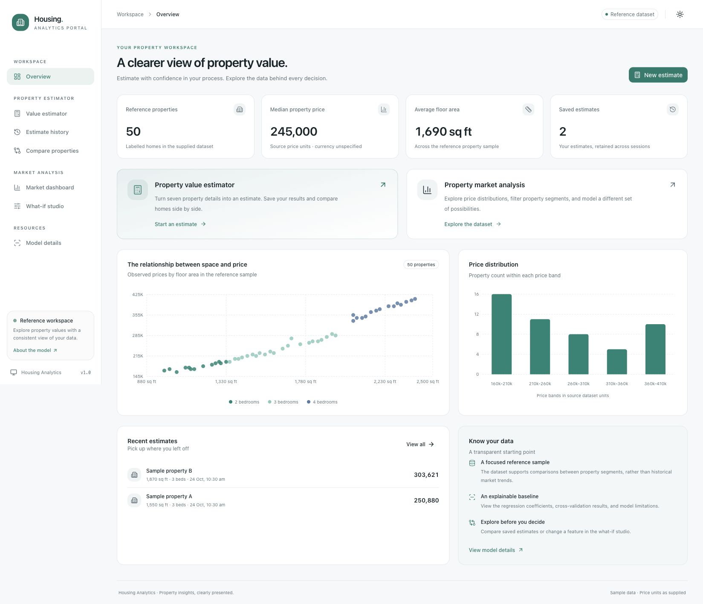

# Housing Analytics Portal

Interview assignment: a housing price model API and a shared Next.js portal with a Python estimator application and a Java market analysis application.

## Implementation status

All four deployables are implemented: the model API, Python estimator API, Java market API, and Next.js portal. The portal includes property estimation, persistent history, side-by-side comparisons, market filters/charts/tables, what-if scenarios, and CSV/PDF exports. It uses Tailwind and shadcn/ui with light/dark/system appearance, responsive navigation, skeleton loading, validation, and error recovery. See the [requirements review](docs/requirements-review.md) and [architecture](docs/architecture-overview.md).

## Run the project

With Docker running, execute from this repository root:

```bash
docker compose up --build -d --wait --wait-timeout 180
```

Open the **[web portal](http://localhost:3000)**. Backend endpoints are available at [model Swagger](http://localhost:8000/docs), [estimator Swagger](http://localhost:8001/docs), and [market health](http://localhost:8002/health).

The first build installs the service dependencies, trains the model, and runs the Java tests. Docker supplies Python 3.12, Java 21, and Node 22 independently of your host installations. `docker compose down` stops the project. Saved estimates survive rebuilds and restarts in the `estimator-data` volume; do not add `--volumes` when you want to retain history.

Optional configuration: copy [.env.example](.env.example) to `.env` and change the published ports, service URLs, or timeouts before starting Compose. Internal URLs use Docker service names. Native development instructions and environment examples live inside each application/service folder. The browser uses a same-origin Next.js proxy; internal API URLs are runtime server configuration, not frontend build constants.

## Repository structure



[Dark-mode preview](docs/screenshots/overview-dark.png)

```text
apps/
  web/                         Next.js, TypeScript, Tailwind, shadcn/ui
services/
  housing-model-api/            FastAPI and scikit-learn regression
  estimator-api/                FastAPI, model integration, SQLite history
  market-api/                   Java 21, Spring Boot 3.4.4, caching, exports
data/
  house-prices.csv              Original labelled data, renamed without editing
  prediction-samples.csv        Original unlabelled examples, renamed without editing
docs/                          Requirements, architecture, evaluation
scripts/                       Stack integration smoke check
```

Each deployable owns its dependency files, tests, and Dockerfile. Root Docker builds use the repository as their build context so services can access the versioned dataset.

## Application guides

- [Model API](services/housing-model-api/README.md): reproducible training, single/batch inference, model metadata, and Swagger.
- [Estimator API](services/estimator-api/README.md): submission validation, model calls, persistent history, and comparisons.
- [Market API](services/market-api/README.md): dataset aggregates, filters, Caffeine caching, scenario calls, CSV/PDF exports.
- [Web portal](apps/web/README.md): routes, frontend state, runtime API configuration, themes, loading/error states, and native development.

Create an estimate, select saved estimates in History to compare them, explore a market segment, download the filtered report, and open a property in the What-if studio. Both application backends call the same model service.

Use [Conventional Commits](https://www.conventionalcommits.org/en/v1.0.0/), for example `feat(model-api): support batch predictions`, `test(model-api): reject missing features`, and `docs: explain service boundaries`.

## Verification

Run service tests from their folders: `pytest -q` for each Python service, `./mvnw verify` for Java (JDK 21), and `npm run typecheck`, `npm test`, `npm run build` for the web app. With Compose running, the dependency-free stack check is:

```bash
python3 scripts/smoke-stack.py
```

It checks real service health, dataset/model fingerprints, filtered statistics, CSV/PDF responses, scenario integration, validation, history, and all portal routes without creating records. GitHub Actions workflows cover the services, web build, and complete container stack; hosted workflow runs are pending repository publication. See [verification notes](docs/verification.md) for local results and limits.

## Data and scope

The two CSVs are unchanged copies of the supplied data. The [evaluation report](docs/model-evaluation.md) documents held-out metrics and limitations. The source does not specify currency, distance/lot-size units, or a rating scale. The UI keeps source units and does not invent time-series market trends. The model is illustrative, with only 50 labelled records.

This is one shared local workspace, with no authentication requirement. Persistent history is shared. A public multi-user deployment needs an authentication/ownership design before storing private user estimates. All published Docker ports bind to loopback by default. GitHub publication and external hosting remain separate deployment steps.
