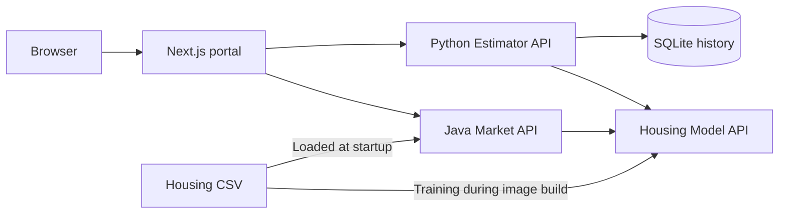

# Housing Analytics Portal

A full-stack implementation of the interview assignment's **Task 1: Housing Price Prediction Model API** and **Task 2: Multi-Application Next.js Portal**. The repository contains a regression model service, a Python property estimator backend, a Java market analysis backend, and one shared web portal.

All four applications are containerised and can be run together locally with Docker Compose. The supplied datasets are included, and the model is trained automatically during the Docker build.

## Start the entire project locally

### Prerequisites

- Docker Desktop running, or Docker Engine with Docker Compose v2.
- Internet access for the first build to download images and dependencies.
- Available local ports: **3000**, **8000**, **8001**, and **8002**. These can be changed in `.env`.

Docker supplies Python 3.12, Java 21, and Node.js 22. Installing those runtimes on the host is only necessary for native development, not for this Docker setup.

### Build and start

Clone or download this repository, then open a terminal in its root folder: the directory containing `docker-compose.yml`. Run:

```bash
docker compose up --build -d --wait --wait-timeout 180
```

The default configuration works without creating an `.env` file. The first build installs dependencies, trains the regression model, runs the Java integration tests, and builds the Next.js application. Compose starts the model first, waits for both application APIs, and then starts the portal. The `-d` option keeps the services running in the background.

Check their status:

```bash
docker compose ps
```

Expect four running, healthy services. Open the portal and API documentation:

| Application | Local URL | Purpose |
| --- | --- | --- |
| Web portal | [http://127.0.0.1:3000](http://127.0.0.1:3000/) | Unified estimator and market analysis UI |
| Housing Model API | [http://127.0.0.1:8000/docs](http://127.0.0.1:8000/docs) | Interactive Swagger UI for single/batch predictions, model information, and health |
| Estimator API | [http://127.0.0.1:8001/docs](http://127.0.0.1:8001/docs) | Interactive Swagger UI for estimates, history, and comparison |
| Market API | [http://127.0.0.1:8002/health](http://127.0.0.1:8002/health) | Java service health and dataset readiness |

The APIs are also available directly on their listed ports. No external model provider, API keys, database installation, or manual model-training step is required for the local demo. Estimate history starts empty on a fresh installation; estimates created through the portal are saved in SQLite.

## What has been delivered

| Assignment area | Delivered functionality | Implementation |
| --- | --- | --- |
| **Task 1: Housing Price Prediction Model API** | `POST /predict` accepts one property or a batch; `GET /model-info` exposes coefficients, intercept, evaluation metrics, feature ranges, and model provenance; `GET /health` reports model readiness. Dockerfile and live Swagger/OpenAPI are included. | Python 3.12, FastAPI, scikit-learn linear regression in [`services/housing-model-api`](services/housing-model-api/) |
| **Task 2, App 1: Property Value Estimator** | Seven-feature property form, client/server validation, prediction table and chart, persistent paginated history, and side-by-side comparison of 2-4 saved estimates. The Python application backend handles submissions and calls the separate model service. | FastAPI, HTTPX, SQLite in [`services/estimator-api`](services/estimator-api/); portal routes under `/estimator` |
| **Task 2, App 2: Property Market Analysis** | Interactive charts, segment filters, aggregate statistics, responsive sortable/searchable tables, model-powered what-if analysis, and filtered CSV/PDF downloads. The Java backend calls the same model service and caches aggregates with Caffeine. | Java 21, Spring Boot **3.4.4**, Commons CSV, PDFBox in [`services/market-api`](services/market-api/); portal routes under `/market` |
| **Task 2: Shared Next.js portal** | App Router, shared navigation/layout, Server Components for initial data, Client Components for interactions, reusable hooks, form/state handling, same-origin API routes, skeleton loading, error boundaries/retry controls, and responsive light/dark/system appearance. UI controls include labels, focus feedback, keyboard interaction, and reduced-motion support. | Next.js 16, React, TypeScript, Tailwind CSS, shadcn/ui, React Hook Form, Zod, and Recharts in [`apps/web`](apps/web/) |

Each deployable has its own dependency manifest and Dockerfile. Compose provides service discovery, startup health dependencies, loopback-bound ports, and a persistent database volume. Runtime containers use non-root users and read-only root filesystems.

## Suggested reviewer walkthrough

1. **Demonstrate Task 1 in Swagger.** Open [model Swagger](http://127.0.0.1:8000/docs), expand `POST /predict`, and use **Try it out**. The example selector includes single and batch requests. Execute `GET /model-info` to inspect coefficients and held-out performance metrics, and `GET /health` to check readiness.
2. **Create property estimates.** Open [Value estimator](http://127.0.0.1:3000/estimator). Submit the prefilled seven-feature form, then change some details and save another estimate. Results include a table, chart, model version, and any range warnings.
3. **Review history and compare.** Open [Estimate history](http://127.0.0.1:3000/estimator/history), inspect saved records, and select 2-4 estimates for [comparison](http://127.0.0.1:3000/estimator/compare). Inputs and predicted prices are displayed side by side.
4. **Explore market segments.** Open [Market dashboard](http://127.0.0.1:3000/market). Filter by bedrooms, price, floor area, or school rating; inspect the updated summaries/charts and sort, search, or paginate the property table.
5. **Run a what-if scenario.** Open [What-if studio](http://127.0.0.1:3000/market/what-if), select a reference property, change a feature, and compare predictions. The Java backend sends the reference and scenario together to the model's batch endpoint. Observed dataset prices are labelled separately from model predictions.
6. **Export and inspect the UI.** Download CSV and PDF from the market dashboard, switch appearance using the header control, and inspect [Model details](http://127.0.0.1:3000/model). Exports include all rows matching the market segment filters; the table's local text search and sort order do not change the export set.

## Stop, restart, and view logs

Run these commands from the repository root:

| Action | Command |
| --- | --- |
| Stop all services, keeping containers and data | `docker compose stop` |
| Start again using the existing images | `docker compose up -d --wait` |
| Rebuild and start after source changes | `docker compose up --build -d --wait --wait-timeout 180` |
| Stop and remove containers and the project network | `docker compose down` |
| View service status | `docker compose ps` |
| Follow all service logs | `docker compose logs -f` |
| Follow one service's logs | `docker compose logs -f market-api` |

Press **Ctrl+C** to exit the log viewer; background services keep running. Saved estimates live in the `estimator-data` named volume and survive `stop`, `down`, and ordinary rebuilds. **`docker compose down --volumes` deletes that saved history.**

Docker runs a built Next.js application. Rebuild after source changes; use the [web development guide](apps/web/README.md) for a native development server with live reloading.

## Architecture and data flow



Server Components load initial data from the configured application APIs. Browser interactions use same-origin Next.js `/api/estimator/...` and `/api/market/...` routes. Both application backends own their model integration; the browser does not connect to Docker-internal hostnames. A shared request hook handles pending/error state and cancels obsolete requests.

The model is evaluated with shuffled five-fold cross-validation using seed 42 and a mean-price baseline, then refitted on all labelled rows for serving. Training occurs during the model image build, not during prediction requests. The Java service caches aggregate responses for five minutes; it does not cache model predictions. See [architecture](docs/architecture-overview.md) and [model evaluation](docs/model-evaluation.md) for the decisions and limitations.

## Optional configuration

Copy [`.env.example`](.env.example) to a root `.env` file if custom settings are needed; edit an existing `.env` rather than overwriting it.

| Configuration | Variables | Default |
| --- | --- | --- |
| Published ports | `WEB_PORT`, `MODEL_PORT`, `ESTIMATOR_PORT`, `MARKET_PORT` | `3000`, `8000`, `8001`, `8002` |
| Backend/model addresses | `ESTIMATOR_API_URL`, `MARKET_API_URL`, `MODEL_API_URL` | Docker service URLs listed in `.env.example` |
| Request timeouts | `API_TIMEOUT_MS`, `MODEL_TIMEOUT_SECONDS`, `MODEL_TIMEOUT_MS` | `15000` ms, `10` seconds, `10000` ms |
| Browser-accessible model documentation | `MODEL_DOCS_URL` | `http://localhost:8000/docs` |
| Sidebar deployment label | `APP_ENVIRONMENT`, `APP_VERSION` | `Testing`, `0.0.1` |

Apply environment changes with `docker compose up -d --wait`, which recreates affected containers. `docker compose restart` alone does not apply changed environment settings. When changing a published host port, update the browser URL and `MODEL_DOCS_URL` as appropriate; keep Docker-internal URLs on their service names and internal ports. API addresses are runtime server configuration, not frontend build constants.

## Verification

With the stack running, execute the integration smoke check using the Python runtime already inside the model container. Run this from the repository root in a Bash-compatible shell:

```bash
docker compose exec -T housing-model-api \
  python - --web-url http://web:3000 < scripts/smoke-stack.py
```

Alternatively, with Python 3.12+ installed on the host:

```bash
python3 scripts/smoke-stack.py --web-url http://127.0.0.1:3000
```

The check exercises service health, dataset/model identity, aggregate statistics, filters, real model integration, CSV/PDF responses, input validation, history, and all seven portal pages. It does not create saved estimates. A successful run prints `Stack checks passed: ...`.

Component tests and native development instructions are in the service guides:

| Component | Guide | Checks after installing the guide's dependencies |
| --- | --- | --- |
| Model API | [Model guide](services/housing-model-api/README.md) | `pytest -q`, Ruff |
| Estimator API | [Estimator guide](services/estimator-api/README.md) | `pytest -q`, Ruff |
| Market API | [Market guide](services/market-api/README.md) | `./mvnw verify` with JDK 21 |
| Web portal | [Web guide](apps/web/README.md) | `npm run typecheck`, `npm test`, `npm run build` |

Run component commands from their respective application/service directories. GitHub Actions workflows cover the model, Python/Java applications, web build, and full-stack smoke check. Recorded local automated, browser, failure-recovery, and persistence results are in [verification notes](docs/verification.md).

## Repository layout

```text
apps/web/                     Next.js portal, components, hooks, and API proxy
services/housing-model-api/   FastAPI model service, training, and tests
services/estimator-api/       FastAPI estimator service, SQLite history, and tests
services/market-api/          Java/Spring Boot market service and tests
data/house-prices.csv         Supplied labelled training/market dataset
data/prediction-samples.csv   Supplied unlabelled prediction examples
docs/                        Architecture, requirements review, and evaluation
scripts/smoke-stack.py       Full-stack HTTP integration check
.github/workflows/           Automated verification workflows
docker-compose.yml           Four-service local orchestration
```

## Data and demonstration scope

The two CSV files are unchanged copies of the supplied data: **50 labelled properties** and **10 unlabelled prediction samples**. The model uses all seven property features and excludes the `id` and `price` columns from its inputs. The unlabelled samples demonstrate inference; they cannot measure prediction accuracy.

The source does not define a currency, distance/lot-size units, or a school-rating scale. Responses and charts retain source units. There are no sale dates or location fields, so market analysis describes property segments rather than historical or regional trends. Cross-validation metrics on this small sample are illustrative; R² is not a confidence percentage or evidence of independent real-market accuracy.

This delivery supports a local, live interview demonstration. History is shared within one workspace; accounts and per-user authorization are not implemented. External hosting and a public multi-user deployment are outside this local setup. See the [assignment requirements review](docs/requirements-review.md) for the mapping from the task brief to the implementation.

## Troubleshooting

- **Docker connection error:** start Docker Desktop/the Docker daemon, then rerun the startup command.
- **Port already in use:** change the affected published port in `.env`, then run `docker compose up -d --wait` and use the new browser URL.
- **Startup timeout or an unhealthy service:** inspect `docker compose ps` and `docker compose logs --tail=100`, resolve the reported error, and rerun startup. The initial dependency/image download can take longer than subsequent starts.
- **Portal cannot reach an API:** check all four services and their logs. Under Compose, API URLs should use service names such as `http://estimator-api:8001`, not `localhost` inside a container.
