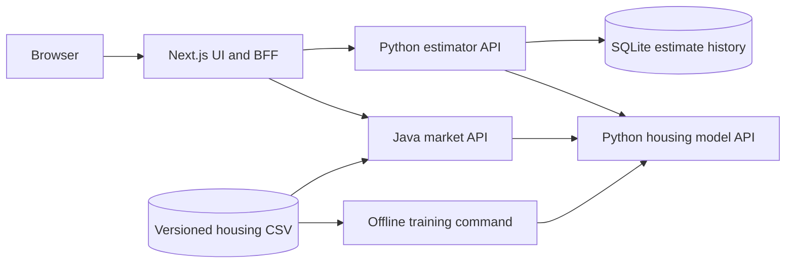

# Architecture overview

Service boundaries, data ownership, model lifecycle, and request handling. See the [project guide](../README.md) for local setup and an ASCII overview of the service relationships.

## Service boundaries

`apps/web` is one Next.js 16 App Router application using TypeScript, Tailwind 4, shadcn/ui (Radix), and Recharts. Shared navigation, layout, design tokens, loading states, and error boundaries live there. Server components fetch initial data. Forms, filters, charts, and comparison controls use client components. React Hook Form and Zod validate form state. Theme preferences persist through next-themes.

`services/housing-model-api` owns feature validation, model training/evaluation, artifact metadata, and inference. It exposes a small stable HTTP contract consumed by both application backends. Training happens separately from request handling. A process loads its artifact once on startup and fails startup if it cannot load a valid artifact.

`services/estimator-api` owns property-estimation workflows, validates submissions, and calls the model with a configurable HTTPX timeout. It saves successful predictions and their original feature values/model versions in SQLite. A named Docker volume retains history across restarts. Comparisons retrieve existing records without recomputing predictions. Failed upstream calls do not save estimates. This is one shared demo workspace; private per-user history would require authentication and ownership checks.

`services/market-api` uses Java 21 and Spring Boot 3.4.4. It validates and loads the dataset once, calculates filtered aggregates, and uses a bounded five-minute Caffeine cache for overview results. What-if scenarios call the model's batch endpoint through Spring RestClient. Commons CSV and PDFBox produce filtered exports. The immutable dataset and its SHA-256 define a process's source version. Loading changed data requires a process restart, or an image rebuild for the CSV copied into Docker; restarting also clears the cache. The dashboard describes cross-sectional sample segments.

## Why keep the estimator API separate?

The estimator owns application workflows and saved records; the model service owns training, model metadata, and inference. This keeps storage and comparison logic independent of the serving model and lets both the Python estimator and Java market service reuse the same prediction contract. The extra HTTP boundary adds latency and container-management overhead, so each caller uses explicit timeouts and handles upstream failures.

## Dataset and artifact ownership

- `data/house-prices.csv` and `data/prediction-samples.csv` are byte-for-byte copies of the supplied files under descriptive names.
- Model inputs are explicitly ordered; `id` and `price` never enter the feature matrix.
- Model artifacts are generated and ignored by Git. Metadata records the dataset SHA-256 and library versions.
- A Docker build uses the repository root as context, copies the service and labelled data, and creates its artifact during the build.
- The model artifact uses joblib for a local scikit-learn object. Load only artifacts produced by this project's trusted training/build process: pickle-based formats can execute code when loaded.

## Regression model

The model uses scikit-learn `LinearRegression` with all seven numeric features. This ordinary least-squares baseline has an intercept and directly inspectable coefficients exposed through `/model-info`. The dataset contains no categorical or missing feature values to encode or impute. Coefficients remain in the original feature units.

Five-fold shuffled cross-validation with seed 42 produces out-of-fold predictions for all 50 houses. Each fold trains only on its training rows. A `DummyRegressor(strategy="mean")` is evaluated on the same splits as a baseline. The serving model is then fitted on all labelled data. No model or hyperparameter selection is performed using those scores.

The small, correlated sample limits generalisation and coefficient interpretation. Individual coefficient signs describe fitted relationships within this sample and do not establish causality. The [evaluation report](model-evaluation.md) records held-out metrics, baseline comparisons, and limitations.

## Request flow and operations

The browser calls same-origin Next.js `/api/estimator/...` and `/api/market/...` Route Handlers. This BFF layer allowlists paths, checks forwarded body size, applies request timeouts, and forwards downloads and structured failures. React Server Components call the configured upstreams directly for initial rendering. Internal service addresses are runtime environment variables and are not baked into browser bundles.

All four published ports bind to loopback. Local clients can call the application and model APIs directly for development and inspection; access is not exclusive to the BFF. Authentication, per-user authorization, and service-to-service authentication are not implemented. There is no public training or artifact-upload endpoint.

Both application backends map invalid input to 422, upstream timeouts to 504, unavailable upstreams to 503, and malformed model responses to 502. They use explicit timeouts and avoid unbounded retries. Dataset-only market analysis and exports remain available if the model stops. Client actions have pending/error states and cancel obsolete requests. Route-level error recovery uses Next.js `retry()` to refetch data.

Root Compose connects all four deployables by service name, supplies readiness dependencies, and gives each runtime a non-root user and read-only root filesystem. Only estimator storage and temporary directories are writable. Root [`.env.example`](../.env.example) documents service URL, port, timeout, and deployment-label overrides. The [service guides](../README.md#verification) cover native development and component checks. Local environment files, generated model artifacts, SQLite files, and dependency/build caches are excluded from Git.

## Primary technical references

- [FastAPI container deployment](https://fastapi.tiangolo.com/deployment/docker/)
- [scikit-learn LinearRegression](https://scikit-learn.org/stable/modules/generated/sklearn.linear_model.LinearRegression.html)
- [scikit-learn cross-validation](https://scikit-learn.org/stable/modules/cross_validation.html)
- [scikit-learn data leakage guidance](https://scikit-learn.org/stable/common_pitfalls.html#data-leakage)
