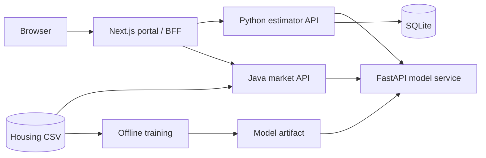

# Architecture

## Boundaries and data flow

- **Web:** Server Components load initial data directly from the application APIs. Client interactions use same-origin `/api/estimator/*` and `/api/market/*` Route Handlers. The proxy allowlists paths, limits forwarded payloads, applies timeouts, and preserves export headers. Service URLs stay in server configuration.
- **Estimator:** Validates submissions, calls the model, and saves successful estimates with inputs, warnings, timestamps, and model versions. Comparison retrieves saved records without rerunning predictions. SQLite lives in a persistent volume.
- **Market:** Loads and validates the CSV at startup. Caffeine caches filtered overviews for five minutes, with at most 128 entries. What-if requests send reference/scenario features together to the model's batch endpoint. CSV/PDF exports use segment filters; table text search and sorting are browser-only.
- **Model:** Evaluates and trains during the image build, then loads its artifact once at startup. Both application backends reuse its prediction contract. Separating model serving from workflows keeps storage and analysis independent of the model implementation.

## Design choices and limits

The model artifact is generated during the image build and versioned using the source SHA-256, implementation version, and numerical library versions. Startup rejects missing or incompatible artifacts. The model service exposes metadata through `/model-info`, so both application backends use the same serving contract.

Application APIs return 422 for invalid inputs, 504 for upstream timeouts, 503 for unavailable services, and 502 for malformed prediction responses. Failed predictions are not saved. Market aggregates and exports work without model serving. The shared client hook cancels obsolete requests; route boundaries provide loading and retry states.

Compose runs four containers with readiness checks, non-root users, and read-only root filesystems. Backend ports bind to loopback for local Swagger access. Fly.io exposes the web app while backends use private Flycast addresses; see [deployment](deployment-fly.md).

History is shared, with no authentication or per-user ownership. SQLite suits a single-instance demo; multiple estimator instances would need a shared database or replication. The market dataset is immutable until restart/rebuild, which also clears its cache. Joblib artifacts must come from the trusted training process; there is no public upload or training endpoint.
