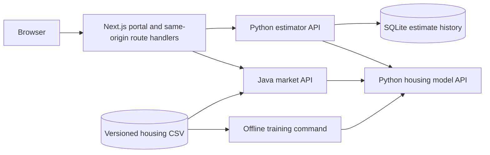

# Architecture overview

## Service boundaries

`apps/web` is one Next.js 16 App Router application using TypeScript, Tailwind 4, shadcn/ui (Radix), and Recharts. Shared navigation, layout, design tokens, loading states, and error boundaries live there. Server components fetch initial data. Forms, filters, charts, and comparison controls use client components. React Hook Form and Zod validate form state. Theme preferences persist through next-themes.

`services/housing-model-api` owns feature validation, model training/evaluation, artifact metadata, and inference. It exposes a small stable HTTP contract consumed by both application backends. Training happens separately from request handling. A process loads its artifact once on startup and fails startup if it cannot load a valid artifact.

`services/estimator-api` owns property-estimation workflows, validates submissions, and calls the model with a configurable HTTPX timeout. It saves successful predictions and their original feature values/model versions in SQLite. A named Docker volume retains history across restarts. Comparisons retrieve existing records without recomputing predictions. Failed upstream calls do not save estimates. This is one shared demo workspace; private per-user history would require authentication and ownership checks.

`services/market-api` uses Java 21 and Spring Boot 3.4.4, as requested. It validates and loads the dataset once, calculates filtered aggregates, and uses a bounded five-minute Caffeine cache for overview results. What-if scenarios call the model's batch endpoint through Spring RestClient. Commons CSV and PDFBox produce filtered exports. The immutable dataset and its SHA-256 define a process's source version; restarting with new data also clears the cache. The dashboard describes cross-sectional sample segments, with no invented market time series.

## Why keep the estimator API separate?

The assignment explicitly asks for a Python application backend that integrates with the Task 1 container and a Java backend doing the same. A separate estimator service shows that boundary even though a smaller real product could combine the Python services. This is a requirement-led design decision, not a claim that more services are always better.

## Dataset and artifact ownership

- `data/house-prices.csv` and `data/prediction-samples.csv` are byte-for-byte copies of the supplied files under descriptive names.
- Model inputs are explicitly ordered; `id` and `price` never enter the feature matrix.
- Model artifacts are generated and ignored by Git. Metadata records the dataset SHA-256 and library versions.
- A Docker build uses the repository root as context, copies the service and labelled data, and creates its artifact during the build.
- The model artifact uses joblib for a local scikit-learn object. Load only artifacts produced by this project's trusted training/build process: pickle-based formats can execute code when loaded.

## First model choice

Start with scikit-learn `LinearRegression` using all seven numeric features. It is an ordinary least-squares baseline with an intercept and directly inspectable coefficients, which supports `/model-info`. There are no categorical or missing feature values to encode or impute. Scaling is not necessary for this unregularised baseline; coefficients remain in source units.

Five-fold shuffled cross-validation with seed 42 produces out-of-fold predictions for all 50 houses. Each fold trains only on its training rows. Evaluate the same folds with a `DummyRegressor(strategy="mean")` so error reductions have a meaningful reference. Then fit the serving model on all labelled data. No model or hyperparameter selection is performed using those scores. A future model comparison would need nested validation or independent labelled evaluation data.

The sample is tiny and strongly correlated. Report evaluation limitations alongside scores. Individual coefficient signs can be misleading because the features move together. Ridge regression is a sensible future comparison if coefficient instability matters, but it introduces scaling and regularisation choices that are unnecessary for the initial contract.

## Request flow and operations

The browser calls same-origin Next.js `/api/estimator/...` and `/api/market/...` route handlers. The server proxy allowlists routes and forwards downloads and structured failures. React server components call the configured upstreams directly for initial rendering. Internal service addresses are runtime environment variables; they are not baked into browser bundles. No cross-origin browser calls or permissive CORS policy is needed. Port 8000 remains loopback-only for local Swagger. There is no public training/upload endpoint.

Both application backends map invalid input to 422, upstream timeouts to 504, unavailable upstreams to 503, and malformed model responses to 502. They use explicit timeouts and avoid unbounded retries. Dataset-only market analysis and exports remain available if the model stops. Client actions have pending/error states and cancel obsolete requests. Route-level error recovery uses Next.js `retry()` to refetch data.

Root Compose connects all four deployables by service name, supplies readiness dependencies, and gives each runtime a non-root user and read-only root filesystem. Only estimator storage and temporary directories are writable. Root `.env.example` documents service URL/port/timeout overrides; service-local examples document native development. Local demonstration comes before choosing external hosting. Secrets, virtual environments, database files, model binaries, recordings, transcripts, and personal preparation notes are excluded from Git.

## Primary technical references

- [FastAPI container deployment](https://fastapi.tiangolo.com/deployment/docker/)
- [scikit-learn LinearRegression](https://scikit-learn.org/stable/modules/generated/sklearn.linear_model.LinearRegression.html)
- [scikit-learn cross-validation](https://scikit-learn.org/stable/modules/cross_validation.html)
- [scikit-learn data leakage guidance](https://scikit-learn.org/stable/common_pitfalls.html#data-leakage)
