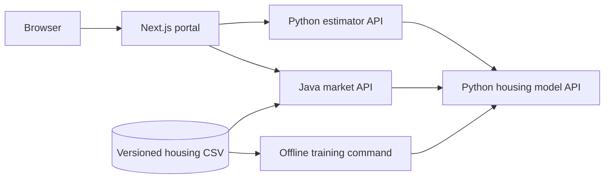

# Architecture overview

## Service boundaries

`apps/web` is one Next.js application with estimator and market routes. Shared navigation, layout, design tokens, loading states, and error boundaries live there. Server components fetch initial data. Interactive forms, filters, charts, and comparison controls use client components. Choose the exact frontend dependency versions when that milestone starts.

`services/housing-model-api` owns feature validation, model training/evaluation, artifact metadata, and inference. It exposes a small stable HTTP contract consumed by both application backends. Training happens separately from request handling. A process loads its artifact once on startup and fails startup if it cannot load a valid artifact.

`services/estimator-api` will own the property-estimation application workflow, validate submissions, and call the model service with a timeout. History and comparison requirements belong to this application. Persistence requirements will determine whether initial browser storage is sufficient or a service database is needed.

`services/market-api` will use Java 21 and Spring Boot 3.4.4, as requested. It will read the housing dataset, calculate segment aggregates, cache suitable responses, call the model API for what-if scenarios, and support exports. The dataset contains no market time series, so the dashboard must describe the sample and its segments accurately.

## Why keep the estimator API separate?

The assignment explicitly asks for a Python application backend that integrates with the Task 1 container and a Java backend doing the same. A separate estimator service shows that boundary even though a smaller real product could combine the Python services. This is a requirement-led design decision, not a claim that more services are always better.

## Dataset and artifact ownership

- `data/house-prices.csv` and `data/prediction-samples.csv` are byte-for-byte copies of the supplied files under descriptive names.
- Model inputs are explicitly ordered; `id` and `price` never enter the feature matrix.
- Model artifacts are generated and ignored by Git. Metadata records the dataset SHA-256 and library versions.
- A Docker build uses the repository root as context, copies the service and labelled data, and creates its artifact during the build.
- The model artifact uses joblib for a local scikit-learn object. Load only artifacts produced by this project's trusted training/build process: pickle-based formats can execute code when loaded.

## First model choice

Start with scikit-learn `LinearRegression` using all seven numeric features. It is an ordinary least-squares baseline with an intercept and directly inspectable coefficients, which supports `/model-info`. There are no categorical or missing feature values to encode or impute. Scaling is not necessary for this unregularised baseline; coefficients remain in source units.

Five-fold shuffled cross-validation with seed 42 produces out-of-fold predictions for all 50 houses. Each fold trains only on its training rows. Evaluate the same folds with a `DummyRegressor(strategy="mean")` so error reductions have a meaningful reference. Then fit the serving model on all labelled data. No model or hyperparameter selection is performed using those scores. A future model comparison would need nested validation or independent labelled evaluation data.

The sample is tiny and strongly correlated. Report evaluation limitations alongside scores. Individual coefficient signs can be misleading because the features move together. Ridge regression is a sensible future comparison if coefficient instability matters, but it introduces scaling and regularisation choices that are unnecessary for the initial contract.

## Request flow and operations

Keep the model API internal to the application backends in the complete portal. The first milestone exposes port 8000 locally for Swagger. There is no browser CORS policy until the frontend's actual request path is chosen. Do not expose an unauthenticated training/upload endpoint.

The next backends should map invalid input to 422, upstream timeouts to 504, and unavailable upstreams to 503. Set explicit timeouts, propagate useful error messages, and avoid retrying requests indefinitely. Cache market aggregates separately from model predictions and include dataset/model version in any relevant cache key.

Use root Compose to connect implemented services by service name. Add each runnable service only when it exists. Local demonstration comes before choosing a hosted deployment. Secrets, virtual environments, model binaries, recordings, and transcripts are excluded from Git.

## Primary technical references

- [FastAPI container deployment](https://fastapi.tiangolo.com/deployment/docker/)
- [scikit-learn LinearRegression](https://scikit-learn.org/stable/modules/generated/sklearn.linear_model.LinearRegression.html)
- [scikit-learn cross-validation](https://scikit-learn.org/stable/modules/cross_validation.html)
- [scikit-learn data leakage guidance](https://scikit-learn.org/stable/common_pitfalls.html#data-leakage)
